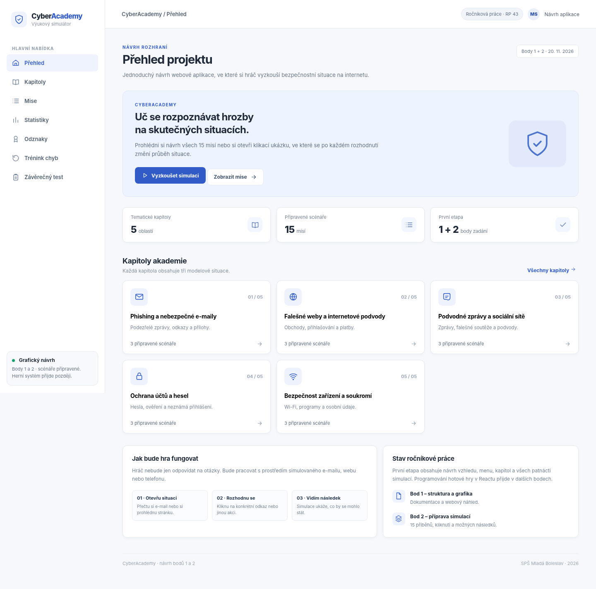

# CyberAcademy

Ročníková práce **RP 43 – Výukový simulátor bezpečnosti na internetu**.

Chtěl bych vytvořit webovou výukovou hru, ve které si hráč sám vyzkouší, jak reagovat na phishing, falešné weby, podvodné zprávy a další hrozby. Po kliknutí se mu bude přímo v simulaci zobrazovat, co se může stát dál.

## Aktuální stav: návrh bodů 1 a 2

- [x] **Bod 1:** návrh struktury, grafické podoby, hlavního menu a 5 kapitol
- [x] **Bod 2:** návrh 15 interaktivních simulací
- [ ] **Bod 3:** výsledná aplikace v Reactu, Vite, JavaScriptu a CSS
- [ ] **Bod 4:** přehled akademie a odemykání misí
- [ ] **Body 5–6:** kompletní interaktivní mise a vyhodnocení
- [ ] **Body 7–8:** XP, odznaky, statistiky a trénink chyb
- [ ] **Body 9–10:** závěrečný test a testování

První termín pro body 1 a 2 je **20. 11. 2026**.

### Dokumentace

- [Bod 1 – návrh aplikace](docs/01-navrh-struktury-a-grafiky.md)
- [Bod 2 – návrh 15 simulací](docs/02-navrh-15-simulaci.md)

### Grafický návrh

Otevři [`navrh/index.html`](navrh/index.html) v prohlížeči. Je to **návrhový prototyp v HTML, CSS a JavaScriptu**, který ukazuje rozložení stránek, všech 15 scénářů a základní klikací vyhodnocení. Zatím se neukládají XP ani postup. Samotná aplikace bude v další etapě převedena do Reactu.

## Technologie plánované pro konečnou aplikaci

React, Vite, JavaScript (JSX), CSS.
