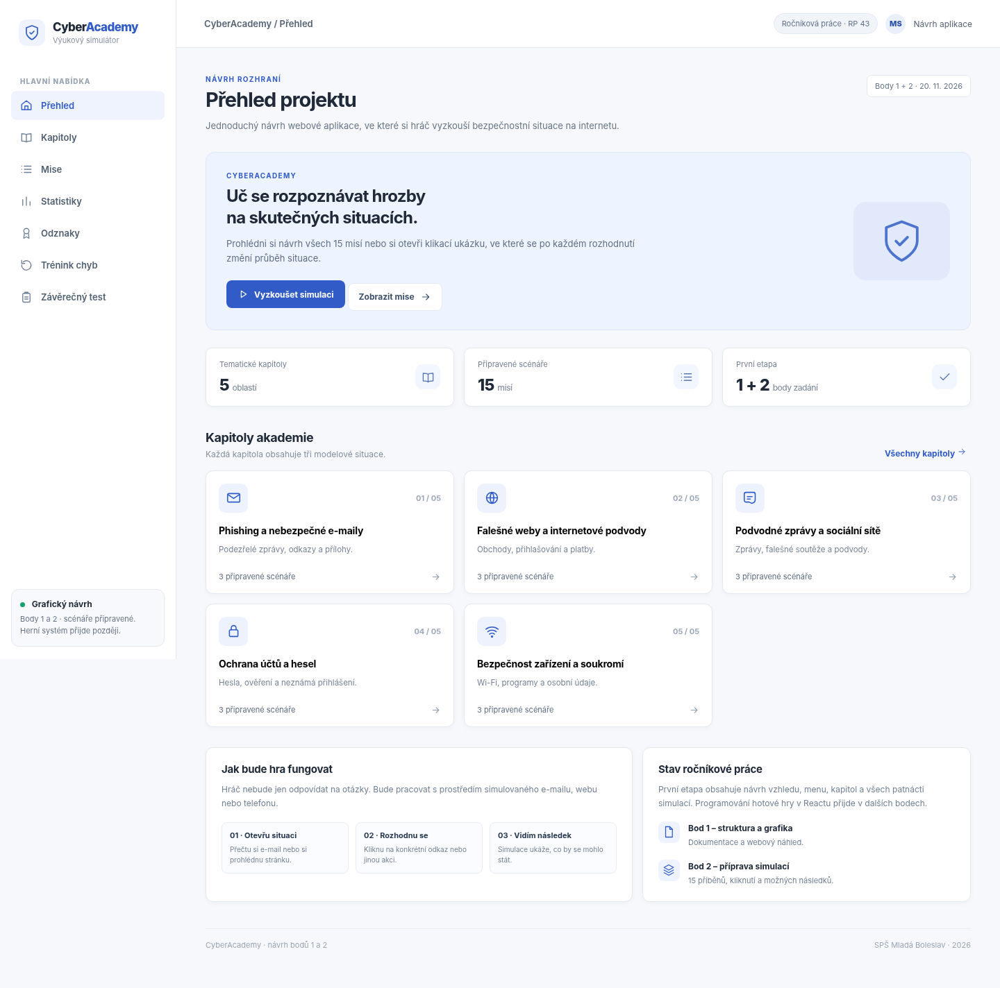
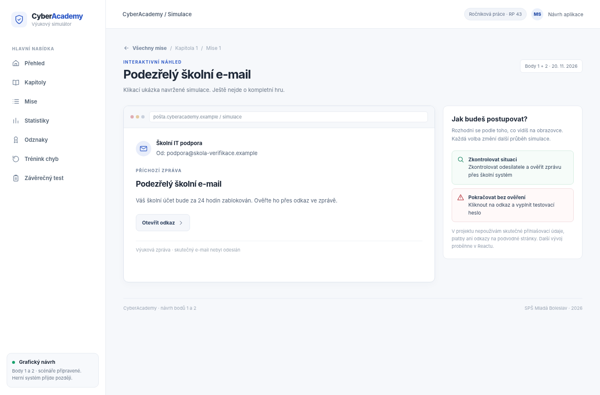

# Bod 1 – Návrh struktury a vzhledu CyberAcademy

**Projekt:** CyberAcademy – Výukový simulátor bezpečnosti na internetu  
**Ročníková práce:** RP 43, SPŠ Mladá Boleslav  
**Termín pro body 1 a 2:** 20. 11. 2026

## Co chci vytvořit

CyberAcademy bude webová výuková hra, ve které si hráč vyzkouší, jak reagovat na různé nebezpečné situace na internetu. Nechci, aby to byl jen obyčejný kvíz s odpověďmi A, B, C. Hráč například otevře podezřelý e-mail, klikne na odkaz, dostane se na falešnou přihlašovací stránku a uvidí, co by se mohlo stát, kdyby tam zadal svoje údaje.

Všechny situace budou bezpečně napodobené. Nepůjde o skutečné útoky a nebudou se zadávat opravdová hesla ani platební údaje. Později chci aplikaci udělat v **Reactu, Vite, JavaScriptu (JSX) a CSS**, jak je uvedeno v zadání. V první etapě připravuji návrh a jednoduchý klikací prototyp.

## Jak bude aplikace rozdělená

Na počítači bude vlevo hlavní menu a vedle něj obsah vybrané stránky. Základní strukturu jsem navrhl takto:

```text
CyberAcademy
├── Přehled
├── Kapitoly (5)
│   └── Mise (3 v každé kapitole)
│       └── Interaktivní situace → následek → vysvětlení
├── Statistiky
├── Odznaky
├── Trénink chyb
└── Závěrečný test
```

Menu bude obsahovat:

| Položka | Co na ní bude |
|---|---|
| Přehled | Úvod, informace o projektu a pokračování v poslední misi |
| Kapitoly | Pět oblastí kyberbezpečnosti |
| Mise | Seznam 15 situací, které si bude moct hráč vyzkoušet |
| Statistiky | Kolik misí hráč dokončil a jak byl úspěšný |
| Odznaky | Ocenění za dokončené úkoly |
| Trénink chyb | Možnost zopakovat mise, ve kterých hráč udělal chybu |
| Závěrečný test | Ověření znalostí po dokončení kapitol |

V této fázi jsou některé položky zatím jen navržené. Statistiky, XP, odznaky a závěrečný test budu programovat až v dalších bodech zadání.

## Pět kapitol

| Kapitola | Téma | Počet misí |
|---|---|---:|
| 1 | Phishing a nebezpečné e-maily | 3 |
| 2 | Falešné weby a internetové podvody | 3 |
| 3 | Podvodné zprávy a sociální sítě | 3 |
| 4 | Ochrana účtů a hesel | 3 |
| 5 | Bezpečnost zařízení a soukromí | 3 |
| **Celkem** | | **15** |

Každá kapitola bude mít tři mise. Začínat se bude první kapitolou a další obsah se bude postupně zpřístupňovat. Celý seznam konkrétních situací je rozepsaný v souboru [02-navrh-15-simulaci.md](02-navrh-15-simulaci.md).

## Grafická podoba

Chci, aby web vypadal normálně jako dnešní webové aplikace. Zvolil jsem **světlé pozadí, bílé karty, tmavý text a jednu hlavní modrou barvu**. Nechci přeplněnou stránku ani výrazné neonové efekty. Důležité pro mě je, aby hráč hned poznal, kde je a co má udělat.

| Prvek | Barva |
|---|---|
| Pozadí stránky | `#F6F8FB` |
| Karty a menu | `#FFFFFF` |
| Hlavní modrá | `#315CC8` |
| Nadpisy a běžný text | `#202A39` |
| Vedlejší text | `#687586` |
| Okraje | `#E4E9F0` |
| Bezpečný výsledek | `#12815C` |
| Rizikový výsledek | `#B83A42` |

Použiju jednoduché ikony, stejný styl tlačítek a dostatek volného prostoru. Obrazovky s e-maily, weby a zprávami budou vypadat podobně jako skutečné služby, ale vždy budou označené jako **simulace**.

### Náhled z webového prototypu





Náhledy vznikly přímo vykreslením webové stránky v prohlížeči. Ve složce `navrh` je také její kód. Web se zároveň přizpůsobuje i užším displejům.

## Jak má hra fungovat

1. Hráč přijde na úvodní stránku.
2. Otevře kapitolu a vybere misi.
3. V misi vidí konkrétní situaci, například e-mail nebo telefon.
4. Klikne na něco v simulovaném prostředí a dostane se na další obrazovku.
5. Uvidí možný následek své volby a vysvětlení, co bylo bezpečné nebo nebezpečné.
6. Později se mu započítá postup, XP a hodnocení podle dalších bodů zadání.

## Co mám připravené

- Návrh hlavního menu a obrazovek.
- Pět kapitol po třech misích.
- Barvy a základní rozložení webu.
- Klikací prototyp, na kterém je vidět zamýšlený vzhled.
- Návrh průchodu hráče simulací.

**Bod 1 je návrh, ne finální hra.** React aplikaci, ukládání postupu a celý systém vyhodnocení budu dokončovat v dalších termínech.
